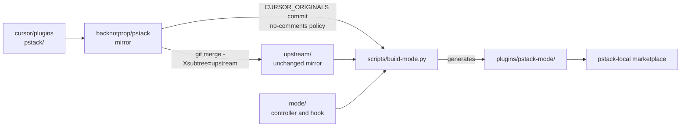

# pstack-mode

A Claude Code plugin that runs a selected part of [pstack](https://github.com/cursor/plugins/tree/main/pstack) as a session mode you start explicitly. The [package guide](docs/pstack-mode.md) covers install, activation, and workers. [Build instructions](docs/build-mode.md) cover regeneration and syncing.

## Where files come from

| Path | Owner | How to change it |
| --- | --- | --- |
| `upstream/` | The backnotprop/pstack mirror, kept byte-identical | Merge from the mirror. Adapt text for this package in `TRANSFORMS` in `scripts/build-mode.py`. Send other changes upstream. |
| `plugins/pstack-mode/` | Generated | Run `python3 scripts/build-mode.py`. |
| `mode/`, `scripts/`, `tests/`, `docs/`, `.githooks/`, `.claude-plugin/` | This repository | Edit, then rebuild and run the tests. |

The pre-commit hook rejects direct edits under `upstream/` and a stale `plugins/pstack-mode/`, and names the fix.
